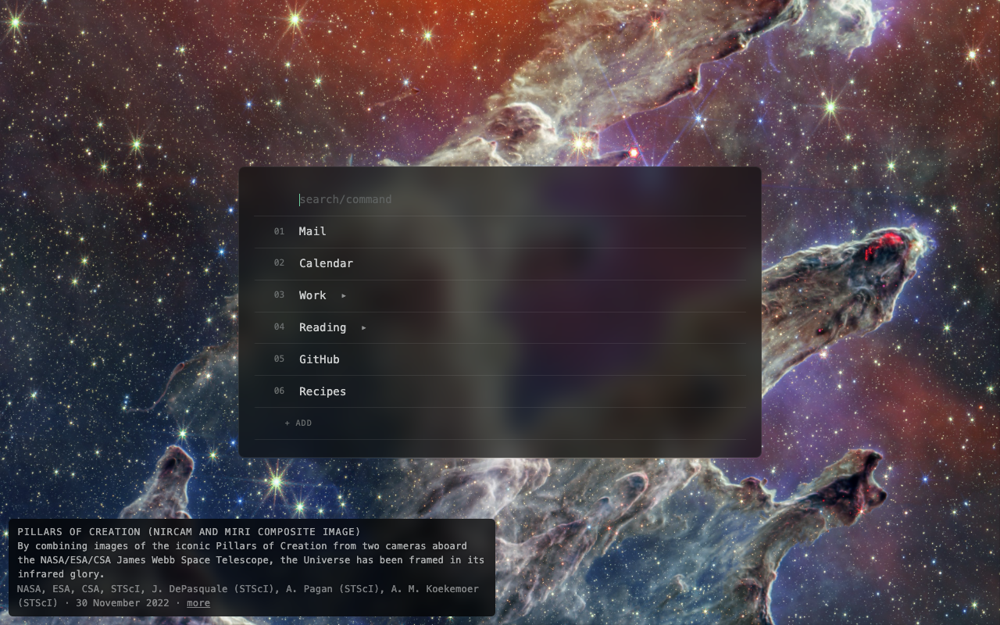

# Space Launcher

A Chrome extension that replaces the new tab page with a keyboard-driven list
of links, over a photograph from the James Webb Space Telescope — a different
one each time. Everything is local to the extension: no accounts, no
analytics, no server. See [PRIVACY.md](PRIVACY.md).



## Installing

From the Chrome Web Store, once it's listed there. That version carries about
eighty photos at 4K.

Or from source, with the full collection (macOS, since the photo script uses
`sips`):

```
git clone https://github.com/morninj/space-launcher && cd space-launcher
python3 scripts/fetch-webb.py     # the photos, into src/webb/ — a few GB
chrome://extensions → Developer mode → Load unpacked → src/
```

Without the photos, the page falls back to a generative background (see
below), so `src/` also works as it is.

## The photos

The photos come from ESA/Webb (esawebb.org/images), NASA
(science.nasa.gov/mission/webb), and the independent processors on Wikimedia
Commons who build their own pictures from Webb's public data — observations
only, no charts, artwork or annotated copies, with a release the sources share
taken once. Each photo sharp enough for a 6K screen is kept whole (`SCREEN` and
`SHARP` in the script), and the big mosaics are also cut into full-resolution
close-ups, which is where most of the collection comes from: a few hundred
pictures and a few gigabytes, so they're fetched rather than committed. Rerun
the script now and then to pick up new releases; it only downloads what isn't
already there. The corner of the page says what the photo is, who to credit,
and links to its page. Without the photos the page falls back to the generative
background described below.

The store package can't carry gigabytes, so `scripts/build-store.py` builds it
from the photos listed in `store/photos.txt`: ESA/Webb (CC BY 4.0) and NASA
pictures only, scaled to cover a 4K screen. It writes
`dist/space-launcher-<version>.zip` without the manifest's `key`, which the
store rejects, and leaves an unpacked copy in `dist/space-launcher/` to try
first. Load that one with the source copy disabled, since only one extension
can own the new tab page. The listing's text, screenshots and permission
justifications are in `store/listing.md`.

Space Launcher is not affiliated with or endorsed by NASA, ESA, CSA, STScI, or
Anthropic.

## The extension's ID

The manifest in `src/` carries a `key`, which pins an unpacked copy's ID to
`cehfjfbjbolhjacpjldfgeihceipjcld`. That matters more than it looks: Chrome
files an extension's stored data under its ID, and an unpacked extension with
no `key` takes its ID from the folder path — so moving or renaming the folder
would orphan every saved link. With the key in place the ID never moves. (The
store version has an ID of its own, and its own saved links.)

## Using it

The list opens with focus in the search box and nothing selected. Type to
filter, or step into the list and work from the keyboard.

`Ctrl+L` (Control, not ⌘) brings the list up in the current tab from any page,
leaving the page you were on one Back away. Chrome assigns it on install; if it
didn't take, or to change it, set it at `chrome://extensions/shortcuts`.

### In the search box

| Key | |
| --- | --- |
| *text* | filters the list; results come out flat, at any depth |
| `1`–`9` | on an empty box, jumps to that row — opens a link, steps into a folder |
| `↓` | steps into the list |
| `↑` `↓` | while searching, walk the results without leaving the box |
| `→` | opens a folder among the results, in place, with the way down to it unfolded |
| `Enter` | opens the selected result; on a heading, unfolds the list down to it |
| `Shift+Enter` | opens it in a new tab |
| `c ` *prompt* | hands the box to Claude; a letter or two picks model and effort |
| `Escape` | clears the search, folds everything, returns here |

A URL typed into the box is treated as somewhere to go rather than something to
look for: `Enter` navigates to it. A full address (with `://`) counts outright;
a bare `example.com/path` counts only once nothing in the list has matched, so
searching for `node.js` still finds your link. Pasting an address goes there
immediately, provided the paste is the whole of what the box holds.

### In the list

| Key | |
| --- | --- |
| `j` `k` / `↓` `↑` | move; `k` on the first row steps back into the search box |
| `h` / `←` | collapses an open folder, otherwise climbs to the folder holding this row |
| `l` / `→` | opens a folder, or steps to its first child if already open |
| `1`–`9` | jumps to a numbered row; on a folder, opens it and selects the first child |
| `Enter` | opens the link, or folds and unfolds a folder |
| `Shift+Enter` | opens in a new tab, and switches to it |
| `a` | adds a link below this one, as a sibling |
| `A` | adds a link inside this one — which turns a link into a folder |
| `e` | edits |
| `d` | deletes, with a `y`/`n` confirmation that counts what goes with it |
| `⌘↑` `⌘↓` | moves the row among its siblings, carrying its children |
| `Escape` | back to the top |

Nesting has no depth limit. A row with children is a folder and holds no URL of
its own: leave the URL blank when adding, or add a child to an existing link.

### Claude mode

Typing `c` and a space in the search box hands it over to Claude: the list
stands aside, and one row shows what will be asked. The space is what arms it,
so a lone `c` is still an ordinary search. `Enter` turns the tab into a new chat
at claude.ai, sets whatever model and effort were asked for, types the prompt in
and sends it — asking is the last thing that happens on a new tab page, so
nothing is left behind it.

A letter between the `c` and the space picks the model — `cf` Fable, `co` Opus,
`cs` Sonnet, `ch` Haiku — and a second letter picks the effort: `l` low, `m`
medium, `h` high, `e` extra, `x` max. So `col` is Opus at low effort and `csx`
is Sonnet at max. Either can be left out (`cl` is low effort on whatever model
is set), and position settles the letters that mean two things: the first is a
model if it can be one, so `ch` is Haiku and `chh` is Haiku at high effort.

Thinking is switched on every time, whether or not an effort was asked for. It
is not a choice the prefix offers; it is one it insists on.

Typing the prefix without its space — `c`, `co`, `col` — puts a quiet legend of
the letters under the list. The search carries on underneath it, since `c` is
also just a letter.

The request rides over in the URL fragment, which never leaves the browser: no
server sees it, and it does not depend on the worker being awake or on the tab
being the one we think it is. `claude.js` reads it at `document_start`, before
the app can rewrite the URL, and takes it straight back out of the address bar.
The worker also parks a copy in `chrome.storage.session` as a fallback, and
hands that over once — a reload will not retype the prompt. Session storage is
closed to content scripts, which is why the page asks the worker rather than
reading it.

The model, the effort and the thinking switch are all set through the same
menus a person would use, in a single visit. Several things had to be learned
the hard way:

- A real mouse sends pointer and mouse events before the click, and these menus
  open on the first of those, so a bare `.click()` goes unnoticed. Hence
  `press()`, which sends the whole sequence.
- A submenu opens when the pointer arrives. Pressing its trigger afterwards
  only shuts what the hover opened, so each way in is tried only while the one
  before it has left it closed.
- The menus stay mounted after they close, so the document can hold several
  copies of the same entry with only one on screen. Everything is looked up
  through `find()`, which skips anything with no layout box; pressing a
  leftover does nothing and explains nothing.
- Order is what keeps it to one visit: the effort levels and the thinking
  switch share a submenu and leave the parent menu standing, while choosing a
  model closes the whole tree. So the model goes last, and its click doubles as
  the way out.
- Escape has to be aimed at the menu element itself, which is where these
  popups listen — after a synthetic click the focus is on the body, where a
  keydown reaches nothing.

claude.ai hydrates before its composer exists, so the script watches for it and
shows a small spinner in the corner while it waits, for up to twenty seconds.
The composer is a ProseMirror document, so the text is typed in rather than
assigned — assigning would leave the editor's own state untouched and the
placeholder showing.

Sending is the one thing that waits on everything else having worked. A chat
opened on the wrong model cannot be taken back, while an unsent prompt costs a
keystroke — so if the model, the effort or the thinking switch did not take,
the text is left in the composer and the corner says why: "Prompt ready,
unsent. High would not stick". The send itself is the same button a person
would reach for, with enter in the composer as the fallback, and the proof
either worked is the box going empty. If the composer cannot be filled at all,
the prompt goes to the clipboard instead, so nothing you typed is lost.

### With the mouse

Click opens; `Shift`-click opens in a new tab. Hovering a row reveals its edit
and delete buttons. Rows can be dragged: near the top or bottom edge of another
row to land beside it, over the middle of a **folder** to land inside it. Plain
links offer no middle — otherwise a stray drop would convert one into a folder.
Dropping on `+ ADD` sends a link to the bottom of the top level. Dragging is off
while searching, since results are a flat view with no order to rearrange.

## How the links are stored

One key, `links`, in `chrome.storage.sync` — so the list follows the Chrome
profile to other machines. A link is `{ id, title, url }`; a folder is the same
with `children` and, when folded, `collapsed: true`. A blank `url` marks a
heading.

`chrome.storage.sync` caps a single item at 8KB. Around 30 links with full
Google Drive URLs comes to roughly 5KB, so the ceiling is real but not close.

Edits made in another tab or on another machine arrive through
`storage.onChanged` and are merged without disturbing what is open here: the
other machine's fold state is theirs, not yours.

## Two things in the code that need explaining

**Focus on a new tab.** Chrome hands focus to the omnibox on its new tab page
and ignores `focus()` from an override, so the list could never take the first
keystroke. `background.js` swaps the tab out: the page asks the service worker
for a replacement, which opens an ordinary tab on `newtab.html?focused` in the
same slot and closes the original. That URL is not the new tab URL exactly, so
Chrome leaves the omnibox alone. The page asks for this itself rather than the
worker watching `tabs.onCreated`, because a tab Chrome has just opened reports
no URL at all — there is nothing there to recognize a new tab by.

**The generative background.** The fallback when `src/webb/` is empty: `webb.js`
loads it only then. `background-art.js` grows filaments through a value-noise
flow field, over a still haze that keeps the empty parts of the screen from
being empty. What the filaments draw stays on the canvas, which is the whole
effect — but the currents barely move, so filaments funnel onto the same
streamlines and those ribbons would go solid and, being additive, wash out to
white. So the canvas is read back every twelfth frame, downscaled to a 64×36
thumbnail, and that map is used twice: a filament lays down less ink the fuller
the water around it is, stopping at a cap, and the map itself is painted back
over the canvas as an eraser, taking away in proportion to what each part is
already holding. Sparse filaments are untouched and still fade over a minute.

## Backups

`chrome.storage.sync` is replication, not a backup: it makes the list appear on
your other machines, and it deletes everywhere when the extension is
uninstalled. Losing an extension's ID — by loading it from a new path without a
`key`, say — loses the links with it.

So `tools/backup-links.py` snapshots the list into `backups/`. It reads
Chrome's own storage for the extension: finding it by the ID derived from the
manifest key (or the one given as its argument — the store version's, say,
from `chrome://extensions`), across every Chrome profile; copying the LevelDB directory first,
since Chrome holds a lock on it; and pulling the JSON straight out of the log.
It writes `backups/links-YYYYMMDD-HHMMSS.json` only when the content differs
from the newest snapshot, and keeps the last 60 — so that is 60 distinct
states, not 60 copies of one.

`tools/space-launcher-backup.plist` runs it every ten minutes and at login.
To install it, from the repo:

```sh
sed -e "s|REPO|$PWD|" -e "s|HOME|$HOME|g" tools/space-launcher-backup.plist \
  > ~/Library/LaunchAgents/space-launcher-backup.plist
launchctl bootstrap gui/$(id -u) ~/Library/LaunchAgents/space-launcher-backup.plist
```

It logs to `~/Library/Logs/space-launcher-backup.log`, and only writes a line when it
takes a snapshot, so an empty log means nothing has changed. Run it by hand any
time with `python3 tools/backup-links.py`. To stop it:

```sh
launchctl bootout gui/$(id -u)/space-launcher-backup
```

Snapshots hold whatever URLs are in the list, so `backups/` is deliberately
kept out of git.

### Restoring

There is no import button, so a restore goes through the page's own console.
Put the write on the clipboard:

```sh
python3 -c "import json,sys;print('chrome.storage.sync.set({links:'+json.dumps(json.load(open(sys.argv[1])))+'})')" \
  backups/links-YYYYMMDD-HHMMSS.json | pbcopy
```

Open a new tab, open that page's console with `⌘⌥J`, paste and run it — Chrome
asks you to type `allow pasting` the first time — then reload the tab.

### If there is no snapshot

Chrome's sync database keeps recently written values for a while after an
extension is gone, as plain JSON inside a LevelDB log. The parsing in
`tools/backup-links.py` works just as well pointed at
`~/Library/Application Support/Google/Chrome/<Profile>/Sync Data/LevelDB/`,
where the value is keyed by the *old* extension ID. This is how the list was
recovered once already, and it is luck rather than a plan — which is what the
snapshots above are for.
